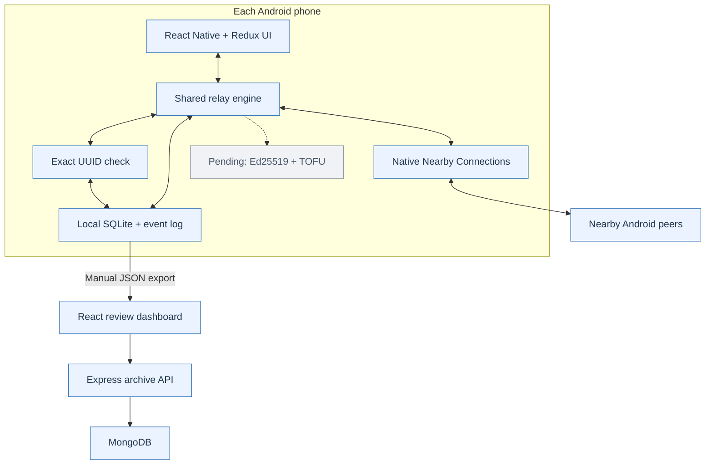

# Architecture and Review 2 boundaries

Blue means **Source implemented**, not that the Android native build or radio tests have passed. Grey means deferred. See the validation report for evidence.

## Processing order

Create: validate input → generate UUID → atomically save/claim → log created → exclude ingress and duplicate peers → sort and cap at K (or All) → decrement hop limit → send → log transfer result.

Receive: size/version/field validation → atomic UUID claim → log receive → display via Redux → if remaining hops > 0 forward to eligible peers except sender, otherwise log ttl_stop. Already-seen UUID → duplicate_drop, no second display/forward.

Later the security verifier must run **before accepting a new alert**. Sign the immutable origin payload separately from mutable relay metadata. Signing a packet and then decrementing its signed TTL invalidates that signature; define the security envelope before implementing the later milestone. TOFU establishes key continuity, not proof that a first-seen sender is an emergency authority.

## Laptop and simulator

The browser simulator instantiates the same JavaScript engine three times, using synthetic links and localStorage. It does not discover phones. The optional Express/MongoDB archive imports snapshots; it neither authenticates mesh participants nor forwards live phone alerts. This preserves the no-central-server runtime requirement.

## Deferred components

Randomized gossip refinements, Bloom filter fast-path backed by exact UUID checks, protobuf, Ed25519/libsodium and TOFU, trusted-authority provisioning, explicit BLE/Wi-Fi Direct adapters, Room/LRU, background service operation, full simulation/measurement tools and the six paper-grade metrics.

## Review 2 additions

The shared engine reads each node's current K setting before forwarding. Web saves
K in a separate localStorage entry, retaining existing Review 1 alerts and logs.
Android saves K in SharedPreferences. No alert wire-format change is required.

packages/core/review.js validates exports, merges same-source snapshots by node and
UUID/event identity, and computes descriptive summaries. Results imports are local;
the original optional archive API uses the same validation. Repeated exports do
not inflate counts. Users must select snapshots from the same experiment; timestamps
alone cannot certify that they belong together.
